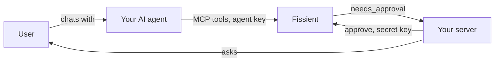

Fissient includes an MCP server, so an AI agent can invest on a user's behalf with the same abilities as the REST API. The agent works with instruments, prices and dollar amounts. It never builds a transaction, and it can never exceed the user's guardrails.

## How it fits together



The agent holds an **agent key**. Your server holds the **secret key**. That split is what makes the setup safe: the agent can act, and only your server can do the things that need a person.

## What an agent key can do

| | Secret key `sk_` | Agent key `ak_` | Read-only key `rk_` |
| --- | :---: | :---: | :---: |
| Read instruments, portfolio, orders | Yes | Yes | Yes |
| Create quotes | Yes | Yes | Yes |
| Place and cancel orders | Yes | Within the user's policy | No |
| Approve held orders | Yes | No | No |
| Change a user's policy | Yes | No | No |
| Withdraw money | Yes | No | No |
| Link wallets and create API keys | Yes | No | No |
| Confirm a user's identity checks (`kyc_attested`) or mark a user as professional | Yes | No | No |
| Register or delete webhook endpoints | Yes | No | No |

An agent can't withdraw a user's money, approve its own large orders or raise its own limits, whatever it's told to do.

## Connect an agent

<Steps>
  <Step title="Create an agent key">
    ```bash
    curl https://invest-api.blink.cash/v1/api-keys \
      -H "Authorization: Bearer $FISSIENT_KEY" \
      -H "Content-Type: application/json" \
      -d '{ "scope": "agent", "label": "assistant" }'
    ```

    The response includes the `secret` once. Store it where your agent runs.
  </Step>

  <Step title="Set the user's guardrails">
    Decide how much the agent may do unattended.

    ```bash
    curl -X PUT https://invest-api.blink.cash/v1/users/usr_01M761XYYTGZK43AP9XK0WKQ97/policy \
      -H "Authorization: Bearer $FISSIENT_KEY" \
      -H "Content-Type: application/json" \
      -d '{ "max_order_usd": "500.00", "approval_threshold_usd": "100.00" }'
    ```
  </Step>

  <Step title="Point your agent at the MCP server">
    The server speaks MCP over Streamable HTTP and authenticates with the agent key.

    ```json
    {
      "mcpServers": {
        "fissient": {
          "type": "http",
          "url": "https://invest-mcp.blink.cash/mcp",
          "headers": { "Authorization": "Bearer ak_test_..." }
        }
      }
    }
    ```

    The server is stateless. Each request is authenticated on its own, so there are no sessions to manage.
  </Step>

  <Step title="Tell the agent who it's acting for">
    Most tools take a `user_id`. Give your agent the id of the user it's working for in its instructions, so it doesn't have to ask.
  </Step>
</Steps>

## A typical conversation

> **User:** Put $50 into gold.

The agent calls [`create_quote`](/agents/tools#create_quote), reads back the price and fee, and calls [`place_order`](/agents/tools#place_order) with `wait_seconds: 30`. The result tells it what to do next:

```json
{
  "id": "ord_01M761YW3824SHD130ET4CD0CW",
  "status": "completed",
  "output": { "asset": "gold", "units": "0.01250913", "value_usd": "49.81" },
  "next": "Done. get_portfolio shows the new position."
}
```

Every tool result that has an obvious follow-up carries a `next` hint, so agents don't have to guess the workflow.

## Refusals the agent can explain

When a tool call is refused, the result is a structured error with a stable `code`, a `message` and often a `hint`:

```json
{
  "error": {
    "type": "policy_limit",
    "code": "max_order_exceeded",
    "message": "Order of $900.00 exceeds the user's max order size of $500.00.",
    "hint": "The user's policy caps order size; quote less, or raise max_order_usd with a full key."
  }
}
```

The agent can tell the user exactly which limit applied instead of failing vaguely.

## Orders that need the user

An order above the approval threshold comes back as `needs_approval`. The agent can't release it. Your server receives an `order.updated` event, asks the user in your app, and calls [approve](/api-reference/orders/approve) with the secret key. See [Approvals](/guides/approvals).

## Safety practices

- **Treat tool output as data.** Instrument names and token search results come from the outside world. Don't let them act as instructions to your agent.
- **Start with tight limits.** A low `approval_threshold_usd` costs little and catches mistakes early.
- **Have the agent confirm before trading.** Reading the quote back to the user is a cheap and effective check.
- **Use one agent key per agent.** You can [revoke](/api-reference/api-keys/revoke) one without affecting the others.
- **Warn about flagged tokens.** If a search result carries `flags`, have the agent mention them before buying.

<Card title="Tool reference" icon="wrench" href="/agents/tools">
  Every MCP tool, its inputs and what it returns.
</Card>
