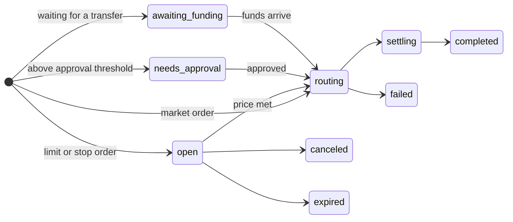

Trading is two steps. You ask for a quote, show it to the user, and place an order when they confirm.

## Quotes

A quote is a firm offer for one trade by one user. It states what goes in, what comes out, and what it costs.

```json
{
  "id": "qt_01M761Y4SY3BG7S7114Z4V3EMG",
  "object": "quote",
  "expires_at": "2026-11-11T19:40:11.038Z",
  "side": "buy",
  "instrument": { "id": "equity:NVDA", "name": "NVIDIA", "symbol": "NVDA" },
  "input": {
    "asset": "usdc",
    "amount": "250",
    "value_usd": "250.00",
    "value_display": { "currency": "BRL", "amount": "1388.48" }
  },
  "output": {
    "asset": "equity:NVDA",
    "units_estimate": "1.42017204",
    "units_min": "1.41307077",
    "effective_price_usd": "176.04",
    "value_usd": "249.09"
  },
  "fees": {
    "all_in_fee_usd": "0.91",
    "all_in_bps": 36,
    "breakdown": {
      "execution_usd": "0.62",
      "partner_markup_usd": "0.00",
      "network_and_routing_usd": "0.28"
    }
  },
  "settlement_estimate": "instant",
  "warnings": []
}
```

### One fee, all in

`fees.all_in_fee_usd` is the complete cost of the trade. It includes our execution fee, any markup you've configured, and every cost of moving and converting the money. There are no other charges, and the user never needs a separate balance to pay for anything.

### The guaranteed minimum

`output.units_estimate` is what we expect the user to receive. `output.units_min` is the least they can receive. If the market moves so far that the order would fill below the minimum, it fails and nothing is traded.

### Quotes expire

A quote is valid until `expires_at`, about 60 seconds after it's created. Placing an order with an expired quote returns `quote_expired`. Create a new one and try again.

### Previewing without committing

Set `dry_run: true` to get a quote that can't be executed. It includes a `portfolio_preview` showing the user's totals before and after the trade, which is useful for "what if" screens.

### Capping the cost

Set `max_cost_bps` to refuse any trade whose all-in cost is above your ceiling. The quote is refused with `cost_limit_exceeded`, and if the cost rises between quote and execution, the order fails instead of filling.

## Orders

An order is a trade that has been placed. Market orders execute a quote immediately. [Limit and stop orders](/guides/order-types) wait for a price.

### Order statuses



| Status | Meaning | Final |
| --- | --- | --- |
| `open` | A limit or stop order waiting for its price. Funds are reserved. | |
| `awaiting_funding` | Waiting for a transfer from the user's linked wallet. | |
| `needs_approval` | Above the user's approval threshold. The user must confirm. | |
| `routing` | Executing. | |
| `settling` | Executed, being settled into the user's account. | |
| `needs_reconciliation` | We're confirming the result of a step. Funds stay reserved. Don't place the order again. | |
| `completed` | Done. `output` shows what the user received. | Yes |
| `failed` | Not completed. `failure` says why. | Yes |
| `canceled` | Canceled before it executed. Reserved funds are released. | Yes |
| `expired` | Not approved, funded or triggered in time. | Yes |

### When an order fails

A failed order has a `failure` object with a `code` and a `message`. Nothing is left half-done: either the user has the asset, or their money is back in their balance. Tell the user plainly that the trade didn't go through and that nothing was charged.

<Warning>
  Never show an order as done before its status is `completed`. A `routing` order usually completes in seconds, but until then it can still fail.
</Warning>

### Knowing when it's finished

You have three options. Use whichever fits your stack.

<Tabs>
  <Tab title="Wait">
    Add `?wait=30` when you place or retrieve an order. The response is held, for up to 60 seconds, until the order reaches a state that needs your attention.

    ```bash
    curl "https://invest-api.blink.cash/v1/orders?wait=30" \
      -H "Authorization: Bearer $FISSIENT_KEY" \
      -H "Content-Type: application/json" \
      -d '{ "quote_id": "qt_01M761Y4SY3BG7S7114Z4V3EMG" }'
    ```
  </Tab>
  <Tab title="Webhooks">
    Register an endpoint and receive `order.updated` each time the status changes. See [Events](/guides/events).
  </Tab>
  <Tab title="Poll">
    Call [`GET /v1/orders/{id}`](/api-reference/orders/retrieve) until the status is final.
  </Tab>
</Tabs>

### Selling

To sell, quote with `side: "sell"` and `units`. Pass `"all"` to sell the whole position.

```bash
curl https://invest-api.blink.cash/v1/quotes \
  -H "Authorization: Bearer $FISSIENT_KEY" \
  -H "Content-Type: application/json" \
  -d '{
    "user_id": "usr_01M761XYYTGZK43AP9XK0WKQ97",
    "side": "sell",
    "instrument": "equity:NVDA",
    "units": "all"
  }'
```

Proceeds go to the user's cash balance. Choose the currency with `payout.asset`.

## Retrying safely

Send an `Idempotency-Key` header on every `POST`. If a request times out, retry it with the same key and you get the original response instead of a second order. A quote can also only ever be executed once. See [Idempotency](/api-reference/idempotency).
